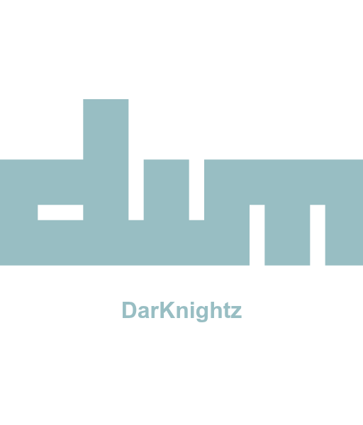

<div align="center">
  

  # DWM — Modern Edition

  A configurable X11 window manager paired with a Quickshell desktop shell.
</div>

This repository contains the DWM fork, Quickshell UI, runtime configuration, and desktop helper scripts. It targets Arch Linux; other distributions may require adapting package names and installation steps.

## Features

- DWM window management with runtime-reloadable TOML hotkeys, themes, and window rules.
- Quickshell panel, workspaces, tray, launcher, Control Center, Settings, System Health, and notifications.
- SysPill resource monitor with RAM/CPU modes and a top-12 process list.
- Hardware controls for audio, microphone mute, and brightness.
- X11 multi-monitor support; the Settings and System Health windows use DWM's per-monitor work area, including reserved panel space.
- Wallpaper-based theme generation, weather, calendar, and desktop update tools.

## Install

See the [installation guide](docs/src/install.md) for dependencies, deployment, and `startx` setup. The project installer supports Arch Linux:

```sh
./install.sh
```

For a source build without the installer:

```sh
make test
sudo make install-system
python3 scripts/dwm-desktop-update record-user .
```

`make test` checks compilation, scripts, TOML configuration, and portability definitions.

## Start an X11 session

With `startx`, `~/.xinitrc` must launch the intended DWM executable. If another `dwm` earlier in `PATH` shadows the installed copy, use its absolute path, for example:

```sh
exec /usr/local/bin/dwm
```

Use the path matching the `PREFIX` selected at build time. A display manager is optional.

## Configuration

User configuration lives in `~/.config/dwm/`; Quickshell configuration lives in `~/.config/quickshell/`. DWM watches its TOML files and reloads them when saved. User files are preserved by setup/update flows, so merge new defaults such as `fillworkarea=1` into existing `window-rules.toml` files when needed.

See the [configuration guide](docs/src/configuration.md), [features](docs/src/features.md), [theming guide](docs/src/theming.md), [updates](docs/src/updates.md), and [security notes](docs/src/security.md). The full manual is available in [`docs/src/`](docs/src/).

## Community

- [Contributing](CONTRIBUTING.md)
- [Code of Conduct](CODE_OF_CONDUCT.md)
- [Security Policy](SECURITY.md)

## Credits

DWM is based on [suckless dwm](https://dwm.suckless.org/). The desktop shell uses [Quickshell](https://quickshell.org/). See [credits](docs/src/credits.md) for other acknowledgments.
