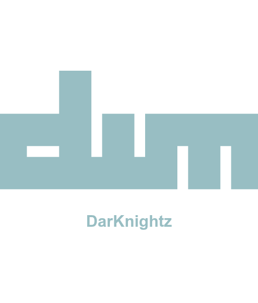

<div align="center">
  

  # DWM - Modern & Hardened Edition
  ### An extremely ***fast***, ***small***, and ***dynamic*** window manager for X.

  [](https://opensource.org/licenses/MIT)
  [](http://makeapullrequest.com)
  [](https://www.linux.org/)

</div>

---

This is a heavily customized fork of dwm designed for a modern, secure, and automated desktop experience. It moves away from the traditional "header-only" configuration, offering dynamic reloading and advanced status integration via Quickshell.

## 🤝 Community Standards

- **[Code of Conduct](./CODE_OF_CONDUCT.md)** - Our pledge for a welcoming community.
- **[Contributing Guide](./CONTRIBUTING.md)** - How to report bugs and submit PRs.
- **[Security Policy](./SECURITY.md)** - How to report vulnerabilities securely.

### 🚀 Key Features

- **Quickshell Integration:** Full EWMH compliance powers a hardware-accelerated desktop shell with dynamic workspaces, running apps, system tray, and control center.
- **Dynamic Hotkeys (TOML):** Change your keybindings in `~/.config/dwm/hotkeys.toml` and they apply **instantly** without recompilation.
- **Live Theme Engine:** Switch between Nord, Dracula, and other themes dynamically. Synchronizes borders, terminals, and Quickshell live.
- **Dynamic Wallpaper Theming:** Native color extraction from any wallpaper generating matching palettes automatically.
- **Hardened Security:** API keys and sensitive location data are isolated into restricted `.env` files with strict 600 permissions.
- **Fully Portable:** The build system uses relative discovery. You can clone and run this repository from any directory.
- **Window Swallowing:** Terminals automatically "swallow" GUI windows launched from them to save screen real estate.

---

## 📚 Documentation

The complete documentation is structured pedagogically and compiled with Rust's **[mdBook](https://rust-lang.github.io/mdBook/)**, hosted on **GitHub Pages** with live full-text search:

- **[Browse Live Documentation Book](https://fam007e.github.io/DWM/)**

To serve the documentation locally with hot-reloading:
```bash
mdbook serve docs --open
```

You can also view the individual source chapters in [`docs/src/`](./docs/src/):
- **[Installation Guide](./docs/src/install.md)** — Dependencies and hardened deployment.
- **[Configuration Guide](./docs/src/configuration.md)** — Dynamic hotkeys and TOML settings.
- **[Key Features](./docs/src/features.md)** — Quickshell shell, Weather Widget, Calendar, and Warm Mode.
- **[System Updates & Releases](./docs/src/updates.md)** — Desktop update manager, receipts, and release pipeline.
- **[Theming Engine](./docs/src/theming.md)** — Wallpaper palette extraction and color sync.
- **[Security Architecture](./docs/src/security.md)** — Secret isolation and IPC hardening.
- **[Migration Audit Log](./docs/src/migration.md)** — Complete chronological engineering log.
- **[Inspiration & Credits](./docs/src/credits.md)** — Upstream and architectural acknowledgments.

---

## 📋 Installation

### 1. Dependencies
This build is optimized for Arch Linux. Install the core dependencies:

```bash
sudo pacman -S --needed base-devel libx11 libxft libxinerama imlib2 libxcb xcb-util \
    xorg-server xorg-xinit xorg-xrandr xorg-xset xorg-xsetroot \
    alacritty picom feh flameshot python python-pillow jq bc curl playerctl \
    brightnessctl xdotool wmctrl zenity libqalculate khal slock
```

If you do not yet have Quickshell installed, install it from the AUR:
```bash
yay -S quickshell
```

### 2. Build & Install
```bash
git clone https://github.com/fam007e/DWM.git
cd DWM
./install.sh
```

### 3. Testing
To verify the build stability and script integrity:
```bash
make test
```

### 4. Uninstall
To remove the build and its configurations:
```bash
./uninstall.sh
```

---

## ⌨️ Keybindings

The default modifier key is **SUPER** (Windows Key).

| Keybind | Action |
|---------|--------|
| <kbd>SUPER</kbd> + <kbd>Return</kbd> | Launch Terminal (Alacritty) |
| <kbd>SUPER</kbd> + <kbd>B</kbd> | Launch Browser (LibreWolf) |
| <kbd>SUPER</kbd> + <kbd>R</kbd> | App Launcher (Quickshell) |
| <kbd>SUPER</kbd> + <kbd>F1</kbd> | Command Menu (Quickshell) |
| <kbd>SUPER</kbd> + <kbd>L</kbd> | **Lock Screen (Slock)** |
| <kbd>SUPER</kbd> + <kbd>SHIFT</kbd> + <kbd>C</kbd> | **Control Center** |
| <kbd>SUPER</kbd> + <kbd>ALT</kbd> + <kbd>B</kbd> | **Bluetooth Menu** |
| <kbd>SUPER</kbd> + <kbd>W</kbd> | **WiFi / Network Menu** |
| <kbd>SUPER</kbd> + <kbd>ALT</kbd> + <kbd>V</kbd> | **Audio & Media Controls** |
| <kbd>SUPER</kbd> + <kbd>ALT</kbd> + <kbd>W</kbd> | **Weather Dashboard** |
| <kbd>SUPER</kbd> + <kbd>ALT</kbd> + <kbd>C</kbd> | **Calendar & Agenda** |
| <kbd>SUPER</kbd> + <kbd>ALT</kbd> + <kbd>P</kbd> | **Power / Session Menu** |
| <kbd>SUPER</kbd> + <kbd>Q</kbd> | Close focused window |
| <kbd>SUPER</kbd> + <kbd>/</kbd> | **Keybindings Help (Live)** |
| <kbd>SUPER</kbd> + <kbd>SHIFT</kbd> + <kbd>N</kbd> | **Toggle Warm Mode (Native C)** |
| <kbd>SUPER</kbd> + <kbd>1-9</kbd> | Switch to tag (workspace) |
| <kbd>SUPER</kbd> + <kbd>Shift</kbd> + <kbd>P</kbd> | Screenshot (Area) |
| <kbd>SUPER</kbd> + <kbd>Shift</kbd> + <kbd>E</kbd> | Quit DWM |

*For a full list of shortcuts, press <kbd>SUPER</kbd> + <kbd>/</kbd> or edit `~/.config/dwm/hotkeys.toml`.*

---

## 🔧 Configuration

This build uses a tiered configuration system:

1.  **Hotkeys & Layouts:** Edit `~/.config/dwm/hotkeys.toml`.
2.  **Themes & Colors:** Edit `~/.config/dwm/themes.toml`.
3.  **Window Rules:** Edit `~/.config/dwm/window-rules.toml` (Swallowing, Floating, Tags).
4.  **Appearance & Logic:** Edit `config.h` (or `config.def.h`) and run `make && sudo make install`.
5.  **Secrets:** Configure your API keys in `~/.config/dwm/secrets/weather.env`.

---

## 📁 Project Structure

| Path | Purpose |
|------|---------|
| `dwm.c` | Core window manager source |
| `config/` | Root for Quickshell, Rofi, and Terminal configs |
| `scripts/` | System backend (Weather, Wallpapers, IPC) |
| `install.sh` | Hardened deployment script |
| `Makefile` | Portable build system |

---

## 🛡️ Security Note
This build enforces strict file permissions (`umask 077`). Cached data and logs in `~/.cache` are owner-readable only to prevent data leakage between users on the same system.

---

## 🌟 Inspiration & Acknowledgments

This project draws significant architectural inspiration from [Chris Titus Tech (CTT)](https://github.com/ChrisTitusTech) and the **[dwm-titus](https://github.com/ChrisTitusTech/dwm-titus)** project, particularly the concept of bridging DWM's X11 engine to Quickshell via custom EWMH atoms and event streaming.

Building on that foundation, this edition has been rewritten and hardened for Arch Linux:
- **Zero Polybar / Rofi Bloat:** Purged all legacy Polybar and Rofi dependencies in favor of native Quickshell widgets and lightweight zero-dependency dialogs (`zenity`, `qalc`).
- **Memory & Safety Hardening:** Audited and resolved monitor reallocation null dereferences, 64-bit integer overflow atom bounds, and untrusted client title injections (`AUD-01` through `AUD-06`).
- **Dynamic Theming Engine:** Built a custom Python median-cut wallpaper color quantization engine (`scripts/dwm-wallpaper-palette.py`).
- **Native Quickshell Weather Widget:** Developed an interactive weather popup card with dual OpenWeatherMap and `wttr.in` fallback.
- **Hardware Warm Mode:** Implemented instantaneous hardware-level color temperature shifts directly in the C engine.
- **Upstream:** Special thanks to [suckless.org](https://dwm.suckless.org/) for the original DWM codebase and [outfoxxed](https://outfoxxed.me/quickshell/) for Quickshell.

