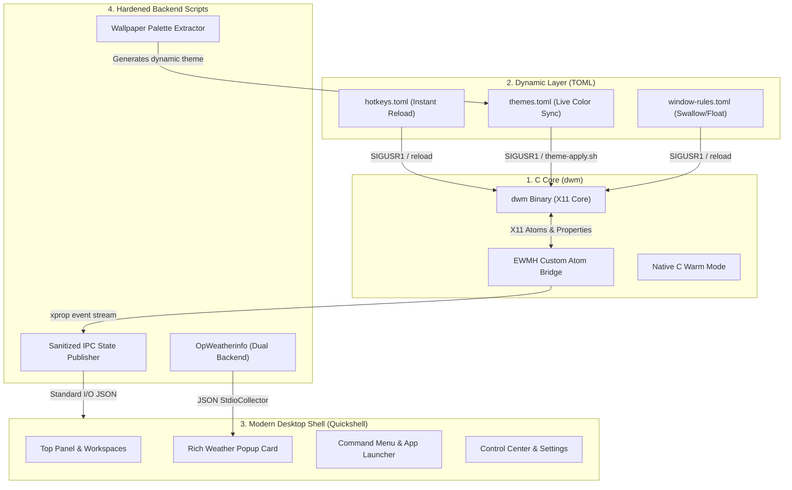

# Introduction

Welcome to the documentation for **DWM — Modern & Hardened Edition**.

This repository is a customized, production-grade fork of the dynamic window manager (`dwm`) for X11, optimized for high performance, architectural security, and modern aesthetic standards on Arch Linux.

---

## 💡 Philosophy & Architecture

Traditional `dwm` configurations require manual recompilation in C for every change — from adding a keybinding to changing a color or altering window behavior. While minimalist, this workflow introduces friction for daily desktop usage.

This edition introduces a **hybrid tiered architecture**:

### Highlights
- **Zero Polybar Bloat:** The legacy polybar and rofi setups are completely eliminated. The desktop is powered by **Quickshell 0.3.x**, offering smooth, hardware-accelerated animations, dynamic workspace buttons with Nerd Font glyphs, running application icons, and rich popup dialogs.
- **Dynamic Configuration (TOML):** Keybindings (`hotkeys.toml`), color palettes (`themes.toml`), and window rules (`window-rules.toml`) are parsed from TOML at runtime. Edit and save — changes apply **instantly** without restarting or recompiling.
- **Dynamic Wallpaper Theming:** With `SUPER + CTRL + w`, choose any wallpaper and our Python median-cut color quantization engine automatically extracts dominant colors, computes complementary contrast, writes a custom theme, and re-themes the entire desktop on the fly.
- **Hardware-Level Warm Mode:** Color temperature adjustment is physically integrated into the C engine with gamma compensation — zero background daemons like `redshift` needed.
- **Security-First Engineering:** Strict `umask 077` sandboxing, sensitive API tokens kept in isolated `0600` secret files, and sanitized IPC string boundaries prevent X11 property injection attacks.
