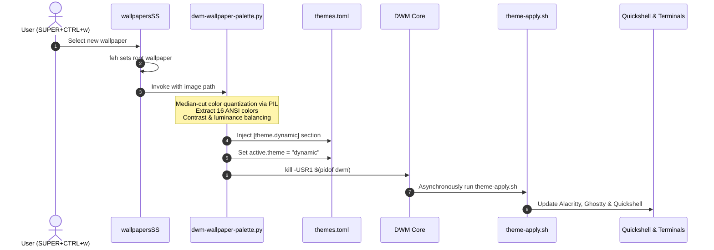

# Theming Engine & Color Synchronization

Desktop customization in this edition is centralized and live-reloaded across the window manager, terminals, and the desktop shell.

---

## 🎨 Centralized Themes (`~/.config/dwm/themes.toml`)

The themes file controls desktop color schemes:

```toml
[active]
theme = "nord" # Switch between nord, dracula, gruvbox, catppuccin, dynamic, etc.

[theme.nord]
name = "nord"
bg = "#242933"
fg = "#d8dee9"
border = "#3b4252"
focus = "#81a1c1"
urgent = "#bf616a"

# Terminal 16-color ANSI definition
color0 = "#242933"
color1 = "#bf616a"
# ...
```

### Supported Palettes Out-of-the-Box
- `nord` (Custom darker Nordic tuned base `#242933`)
- `dracula`
- `gruvbox`
- `catppuccin`
- `tokyonight`
- `onedark`
- `solarized`
- `rosepine`
- `everforest`
- `monochrome`
- `dynamic` (Wallpaper-derived)

---

## 🖼️ Dynamic Wallpaper Color Extraction

The dynamic theming engine (`scripts/dwm-wallpaper-palette.py`) provides an automated workflow to match your entire environment to whatever wallpaper you select.



### How to Trigger
- Shortcut: Press <kbd>SUPER</kbd> + <kbd>CTRL</kbd> + <kbd>w</kbd>
- Direct CLI: `wallpapersSS`
- Select any image; DWM borders, terminal colors, and Quickshell components shift to harmonize with your wallpaper.
