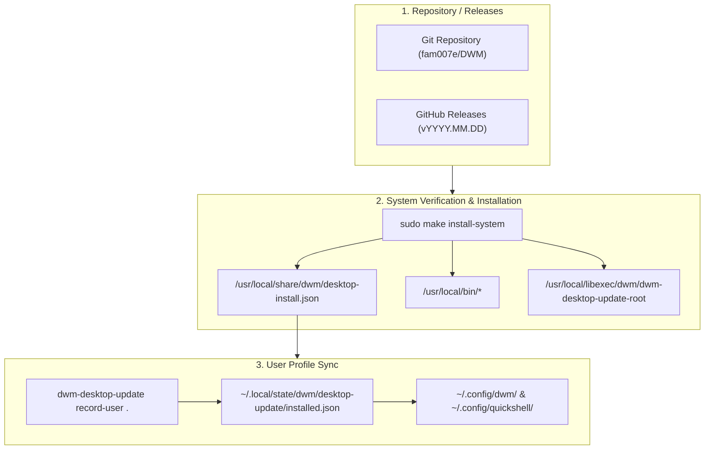

# System Updates & Release Architecture

This edition features a hardened, automated desktop update management framework designed to ensure seamless updates, dependency synchronization, and configuration integrity without breaking user customizations.

---

## 🔄 Desktop Update Manager (`dwm-desktop-update`)

The core update orchestrator is `scripts/dwm-desktop-update`, which manages both system-wide binaries and user-level desktop configurations.



### Key Capabilities
- **Two-Tier Installation Receipts:**
  - **System Receipt (`/usr/local/share/dwm/desktop-install.json`):** Tracks installed system binaries, helper scripts in libexec, man pages, X session files, and package dependencies.
  - **User State Receipt (`~/.local/state/dwm/desktop-update/installed.json`):** Tracks user-level config versions, migration states, and prevents unintended overwrites of user modifications in `~/.config/dwm/`.
- **Atomic Helpers (`dwm-desktop-update-root`):** Privileged operations (package installation, root helper execution) run through a dedicated helper script located at `/usr/local/libexec/dwm/dwm-desktop-update-root`.
- **Non-Destructive User Config Protection:** When updating, user configuration files (such as custom hotkeys or theme tweaks) are preserved; newly introduced defaults are merged or placed into template backups rather than clobbering user settings.

---

## 🛠️ Performing Updates

### Recommended CLI Update

To manually apply updates from source:

```bash
cd ~/Github/DWM
git pull origin main

# Recompile and install system binaries + record system receipt
sudo make install-system

# Synchronize user configurations and record state
python3 scripts/dwm-desktop-update record-user .
```

### Quickshell Update Center

The desktop shell provides a graphical Update Center accessible via <kbd>SUPER</kbd> + <kbd>SHIFT</kbd> + <kbd>U</kbd>, the top panel indicator icon, or Control Center:
- Checks remote Git repository status and release availability in the background (`dwm-quickshell-version-check`).
- **Developer vs. End-User Awareness:** Distinguishes between developer working checkouts (local modifications or development branches) and clean end-user installations. In developer checkouts, status reports `Developer checkout` without blocking or conflicting, preserving developer source modifications while providing clear context.
- Displays available package updates, system health status, and changelogs.
- Launches authenticated update procedures with progress feedback (`dwm-desktop-update-progress`).

### Desktop Update Recovery

If an update is interrupted (e.g. power loss or authorization cancellation), the transactional update framework guarantees full rollback capability:
- In the Quickshell Update Center (<kbd>SUPER</kbd> + <kbd>SHIFT</kbd> + <kbd>U</kbd>), the DWM row will display **"Recovery required"** with an interactive **"Recover"** button.
- Alternatively, run the recovery command directly from terminal:
  ```bash
  dwm-update-center recover dwm
  # or directly via updater:
  dwm-desktop-update recover <operation-id>
  ```

---

## 🏷️ Release Workflow & Tagging Convention

Releases follow a deterministic date-based versioning scheme:

```
vYYYY.MM.DD (e.g., v2026.10.13)
```

### Automated Release Pipeline (`.github/workflows/create-release.yml`)

When a version tag matching `v*` is pushed to GitHub, an automated workflow executes:
1. **Multi-Job Verification:** Clones repository with full Git history for accurate changelog generation.
2. **Hardened Compilation:** Builds the `dwm` binary with `-O2` optimizations and system dependency headers.
3. **Release Packaging:**
   - Bundles the compiled binary, session entry (`dwm.desktop`), shell configurations, scripts, and documentation into a clean tarball (`dwm-<version>.tar.gz`).
   - Excludes Python bytecode caches (`__pycache__`, `*.pyc`) and temporary build artifacts.
   - Computes SHA256 checksums (`sha256sum`) for cryptographic verification.
4. **Automated Changelog:** Extracts commits between the previous and current tag to produce a clean, structured release notes document.
5. **GitHub Release Publication:** Publishes the release asset tarball, checksum file, and changelog directly to GitHub Releases.
